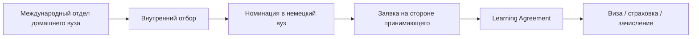

# Обзор программ обмена в Германии

[[index]] · [[02-exchange/|02 — Программы обмена]]

Краткая карта механизмов, через которые студенты (в т.ч. медицинского профиля) могут провести семестр, практику или исследовательский стаж в Германии. Для студентов российских медвузов путь зависит не только от правил принимающего вуза, но и от **статуса вуза-отправителя** в международных программах после 2022 г.

## Четыре основных механизма

| Механизм | Суть | Заявка | Типичная длительность | Финансирование |
|----------|------|--------|----------------------|----------------|
| [[erasmus-plus\|Erasmus+]] | Европейская программа мобильности между вузами-партнёрами | Через международный отдел **вуза-отправителя** | 2–12 мес. (семестр/стажировка) | Грант Erasmus+ (ежемесячная стипендия + организационная поддержка) |
| [[daad-exchange\|DAAD]] | Немецкий сервис академического обмена: стипендии, каталог программ, координация | Через вуз, напрямую в DAAD или через партнёрскую программу | От 1 мес. до полного курса (зависит от программы) | Стипендии DAAD, иногда — только организационная поддержка |
| [[bilateral-agreements\|Bilateral agreements]] | Двустороннее соглашение между конкретными вузами | Через координатора обмена в **своём** вузе → номинация в принимающий | 1–2 семестра | Часто без tuition; стипендия — по соглашению или отдельно |
| [[freemover\|Freemover]] | Самостоятельная организация без рамочного соглашения | Напрямую в принимающий вуз / клинику | Обычно 1–3 мес. (практика); семестр — реже | Самофинансирование; стипендии — отдельный поиск |

## Как выбрать механизм

1. **Уточнить у международного отдела своего медвуза:** есть ли действующее соглашение с немецким вузом (Erasmus+ или bilateral), кто координатор, актуальны ли договоры после 2022 г.
2. **Если соглашений нет или они заморожены** — рассматривать [[freemover|Freemover]] (клиническая практика / стаж) или отдельные стипендии [[daad-exchange|DAAD]] (если подходите по критериям).
3. **Для семестра обучения (курсы, ECTS)** — чаще bilateral или Erasmus+; для **клинической практики (Famulatur/PJ-элемент)** — чаще Freemover или отдельные клинические программы факультета.
4. **Язык:** для медицинского обмена в гос. вузах обычно требуется **немецкий B2+**; отдельные программы / исследовательские стажи — на английском.

## Типичный цикл (bilateral / Erasmus+)

## Официальные точки входа

- DAAD (обзор, стипендии): https://www.daad.de/en/
- Erasmus+: https://erasmus-plus.ec.europa.eu/
- Study-in-Germany (обмен): https://www.study-in-germany.de/en/plan-your-studies/study-options/exchange-programmes/

## Актуально для студентов из РФ

- **Erasmus+ и российский вуз-отправитель:** с 8 апреля 2022 г. Еврокомиссия прекратила участие **российских публичных организаций** (включая гос. вузы) в Erasmus+; новые соглашения с такими организациями не заключаются. Практический вывод: обмен **через российский медвуз по Erasmus+** для большинства студентов **недоступен** — статус уточнять в международном отделе. Индивидуальная мобильность (ICM) теоретически возможна в отдельных кейсах, но не через приостановленное институциональное партнёрство.
- **Bilateral:** зависит от **конкретной пары вузов**; многие немецкие вузы приостановили сотрудничество с российскими партнёрами после 2022 г. — договор в списке ≠ действующий обмен.
- **DAAD:** с февраля 2022 г. нет стипендий **на учёбу в России**; офис DAAD в Москве закрыт (февраль 2026, статус «нежелательной организации» в РФ). Россияне **могут подавать** на стипендии DAAD для поездки **в Германию**, в т.ч. из третьих стран; внутри РФ консультации DAAD недоступны.
- **Freemover:** наиболее реалистичный путь для **краткой клинической практики** без институционального соглашения; приоритет у студентов партнёрских вузов, места ограничены.
- **Виза:** для граждан РФ — национальная виза типа D (студенческая / стажировка); blocked account, страховка, сроки консульства — планировать за 3–6 мес.
- **Практический шаг:** письменный запрос в международный отдел своего медвуза + прямой контакт с International Office / Medizinische Fakultät целевого немецкого вуза.

## Детальные заметки

- [[erasmus-plus|Erasmus+]]
- [[daad-exchange|DAAD — программы обмена и стипендии]]
- [[bilateral-agreements|Двусторонние соглашения (bilateral)]]
- [[freemover|Freemover — самостоятельная организация]]

## Источники

- https://www.daad.de/en/
- https://erasmus-plus.ec.europa.eu/
- https://www.study-in-germany.de/en/plan-your-studies/study-options/exchange-programmes/
- https://education.ec.europa.eu/news/termination-of-cooperation-with-russian-public-entities-in-research-and-education
